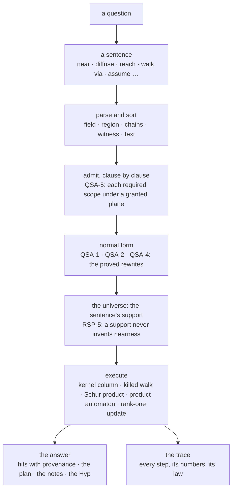
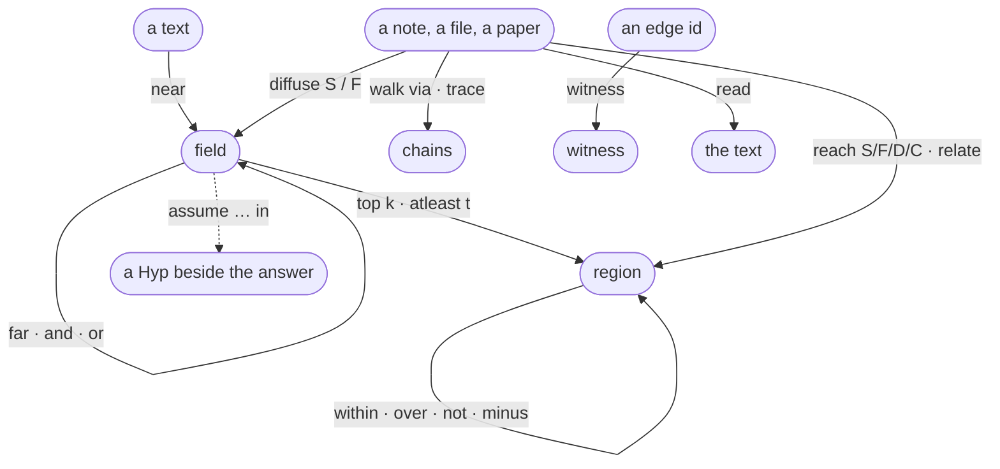
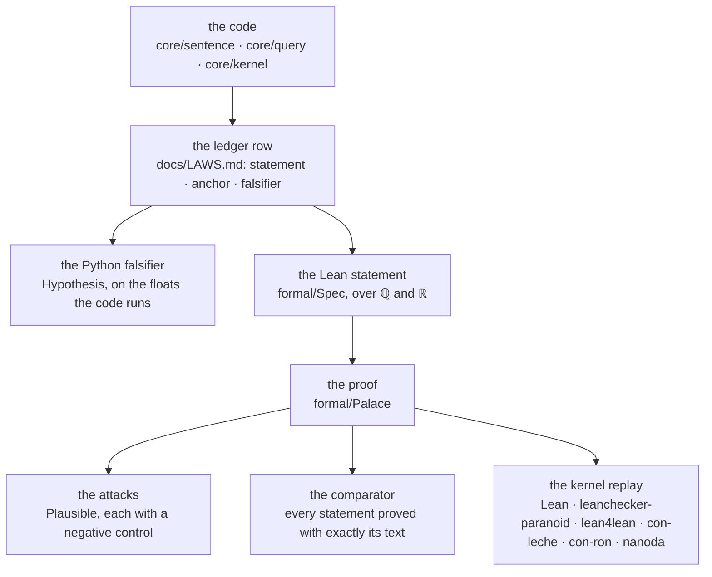

# Mind Palace

[](https://github.com/ascalva/mind-palace/actions/workflows/ci.yml)
[](https://github.com/ascalva/mind-palace/actions/workflows/lean.yml)
[](docs/LAWS.md)
[](formal/README.md)
[](formal/sorry-budget)
[](formal/check.sh)
[](formal/PalaceTest)
[](docs/runbook.md)
[](pyproject.toml)
[](pyproject.toml)
[](scripts/check_imports.py)
[](pyproject.toml)
[](LICENSE)

> A memory you ask in sentences. Every answer carries its plan, its provenance and — on request — its proof of work, and every operation it runs is a law stated in a ledger and proved in Lean.

Two names, deliberately: **mind-palace** is the framework — this repository. **Ouroboros** is the live instance — the always-on daemon over one person's notes, code and reading, named by its own founding note ("is that the name i would give this study on process? ouroboros"). The framework is public; the corpus never is.

## The language is the interface

A human at a terminal and an agent over MCP ask the same thing in the same way: a sentence of the query algebra. Not keywords, not a prompt — a term with a sort, compiled under a grant.

```text
top 5 near "sleep" and diffuse S from "health.md"
reach F from "core/sealing.py" depth 2 as of "9ec8689"
top 8 near "Kaplansky's direct finiteness" over curated
walk from "note-2026-07-11-000843" via S+F* depth 3
assume sever S "a.md" "b.md" in top 3 diffuse S from "a.md"
read "reference:openai-math:Local-smoothing" chunk 3
```

The nouns are the five **sorts**: a *field* (a score over every node), a *region* (a set of nodes), *chains* (paths with a word over the edge types), a *witness* (the commit that minted an edge) and a *text* (one record). The **verbs** move between them — `near`, `diffuse`, `reach`, `relate`, `trace`, `walk … via`, `witness`, `read` — and the **connectives** compose them: `and`, `or`, `minus`, `then`; the adjectives `within`, `over`, `as of`; the bounds `top k`, `atleast t`, `far`, `not`; and the modality `assume … in`, a hypothetical whose answer is a `Hyp` beside the actual one, never a fact. The grammar is `core/sentence/grammar.py`; the translation guide for anyone asking is [`docs/query/asking.md`](docs/query/asking.md).

Two surfaces, one grant. `mind-palace query "<sentence>"` runs a sentence read-only from the live checkout; the Ambassador's MCP server exposes exactly one read tool, `query`, with a `sentence` argument, and the Open WebUI bridge serves the same manifest. Both run under the Ambassador's grant with the hypothetical overlay the owner switched on; `--as <role>` labels the asker for the query log and grants nothing. A refusal is a question back: it names the production, the sort rule, the plane no grant covers or the ambiguous note — never a nearest-neighbour mush that looks like an answer.

## From a sentence to an answer



Each stage is a theorem's customer. The compiler types the sentence and checks, clause by clause, that each clause's required scope — its strata, edge classes, clock and window — lies under one of the grant's planes (QSA-5), so an ill-scoped sentence never exists. The planner rewrites to a normal form by identities proved before the code was written: `within` is pushed to the leaves because a mask distributes over the Schur product and masks stack by intersection (QSA-2); `and` is flattened and ordered because the product is commutative and associative (QSA-1); a positive threshold passes a mask and a `top k` does not (QSA-4). The universe builder bounds the evaluation to the sentence's support — the notes and the dialogue always, papers and code by nearest-neighbour seeding, the citation graph at the sentence's cut — and keeps the full graph's degrees on it, which is exactly the hypothesis under which a support under-estimates nearness and never invents it (RSP-5). The executor then does arithmetic whose laws are the ledger's.

## The verbs and their mathematics



| sentence | the mathematics it runs | the laws |
|---|---|---|
| `near "t"` | the kernel column `clip(V·q̂, 0, 1)`: one cosine per node, never an `n × n` product | QSA-3 |
| `diffuse S from n [beta b]` | the randomized-shortest-path curve: `W_β = z·D⁻¹W∘W^β`, `Z = (I − W_β)⁻¹`, `φ_ij = −log(z_ij / z_jj)/β`, `score = e^{−φ}`; β→∞ is shortest path, β→0 resistance; on a support, with the graph's degrees | RSP-1 to RSP-5 |
| `f and g`, `f or g` | the Schur product `f ⊙ g`, which keeps the positive cone; the convex mixture | QSA-1, QSA-3 |
| `s within r`, `s over σ`, `r then s` | masks: congruences of the kernel that distribute and stack by `∩`; `over` is the mask onto strata | QSA-2, QSA-10 |
| `top k f`, `atleast t f` | ranking, which does not commute with a mask; a threshold, which does | QSA-4 |
| `reach F from n depth d` | breadth-first over the typed edges at the sentence's cut | — |
| `walk from n via p` | the product of the typed graph with the regular expression's automaton, dead states pruned | QSA-7 |
| `assume S a b +w in s` | a rank-one update `L ↦ L + w(e_a − e_b)(e_a − e_b)ᵀ`; adding weight lowers every effective resistance, removing it raises every one; the sever horizon `w·R_eff ≤ 1`, equal to one exactly at a bridge | QSA-9, CND-2, SEV-3 to SEV-5 |
| `assume contradict a b in s` | a negative relation edge; the signed Laplacian's zero mode lifts iff the camps break, by at most `4·F_w/n` | LAP-5, LAP-6, FRU-1, FRU-2 |
| `read r [chunk n]` | the record, held to the stratum its ref names | — |

## Secure by construction

Every node carries its stratum — the owner's notes, the dialogue, the curated literature, the repository's code, the interpreted layer, the observed layer, and the hypothetical overlay — and every clause names the strata it walks. A grant is a set of scopes, one per clock plane; a sentence is admitted only when each clause fits under one, and the clearance a clause reads with is minted from the admitted scope, after admission, never before. The Ambassador's base grant admits no hypothetical; the owner's overlay grant names the overlay stratum on each plane and widens nothing else — no world reach, the same clocks, windows and fibers (QSA-5). The read-only mirror of what the owner wrote and the write-only path to the world are distinct objects, by type; the sealed core cannot name a network module, and an import firewall proves it. The query log is a sensor — surface, role, strata, modes, outcome, the class of a refusal — and holds no note's text.

## Show the work

`--trace` (the MCP tool's `trace: true`) carries the proof of work with the answer: the parse and its sort; every rewrite of the normal form with the law it rests on; the clauses' scopes and modes and the admission; the support's census; each clause's arithmetic with its numbers; a hypothetical's rank-one update and its sever horizon; the ranking; and the laws cited, once each. Refs and numbers only — never a note's text — and off, every hook is one `None` check.

```text
trace (the proof of work):
  plan:
    - `and` ordered canonically: the Schur product is commutative and associative  [QSA-1]
    - within stays over `top`: ranking does not commute with the mask  [QSA-4]
    - admissible: each of the 3 clauses' required scopes lies under a granted plane  [QSA-5]
  eval:
    - reach F from 'a.md' depth 1 both: breadth first over the typed edges, frontiers [1]; 1 reached
    - diffuse S from 'a.md': the killed walk W_β = z·D⁻¹W∘W^β on 4 nodes and 2 edges, β = 1, z = γ = 0.5; Z = (I − W_β)⁻¹, φ_aj = −log(z_aj / z_jj)/β, score e^{−φ}; 2 nodes reachable; best: b.md 0.3405, c.md 0.0989  [RSP-1, RSP-4]
    - near 'q': the kernel column s = clip(V·q̂, 0, 1) over 4 nodes; 2 positive; best: a.md 0.9487, b.md 0.3162  [QSA-3]
    - and: the Schur product f ⊙ g; 2 positive ⊙ 2 positive → 1 positive; best: b.md 0.340×0.316=0.1077  [QSA-1, QSA-3]
    - top 2: 1 kept of 1 positive scores, ties kept; the cut is 0.1077  [QSA-4]
  laws: QSA-1, QSA-4, QSA-8, QSA-5, RSP-1, RSP-4, QSA-3, QSA-2 — the ledger rows in docs/LAWS.md, the design theorems in formal/Palace/
```

## How a law becomes a proof



A law gets one row in [`docs/LAWS.md`](docs/LAWS.md): its statement, the structure it rests on, the code it anchors to, its label, the Python test that would catch it false, and the Lean declarations that state it. The Lean side is a sibling package with no import coupling to `core/` in either direction: a model of the code's definitions (`formal/Palace/X/Defs.lean`), the statements over them with their proofs left open (`formal/Spec/X.lean`), and the proofs (`formal/Palace/X.lean`). `lake comparator` judges the proofs against the statements, so a proof file cannot change what is proved; the export of everything the statements reach is replayed from nothing through Lean's kernel and five independent checkers, two of them formally verified; every declaration is audited against the three standard axioms; the `sorry` budget is zero and only goes down; and a cross-reference check holds the ledger, the statements and the docstring markers to one another. Design theorems — laws proved before any code relies on them — live in `formal/Palace/` under their own ids and enter the ledger when code does.

| | |
|---|---|
| toolchain | Lean `v4.36.0-rc2`, Mathlib; Plausible for the attacks |
| the library | 25 proof modules, 24 models, 19 statement files; 13,106 lines of models and proofs, 2,251 of statements, 2,551 of attacks |
| theorems | 755 proved in `formal/Palace`; 205 statements in `formal/Spec` judged identical by the comparator |
| the ledger | 79 rows in 11 families, 211 cited declarations, 66 law markers checked against the rows |
| attacks | 96 Plausible attacks and 97 negative controls over 22 modules, fixed seeds |
| axioms | `propext`, `Classical.choice`, `Quot.sound`; `sorry` 0 |
| the replay | 44,896 declarations accepted by all six checkers on every run of `formal/check.sh` |
| families | memberships · Laplacian, balance and spectral · cut and conductance · curvature · the global event clock · the shared prose plane · capability scopes · the abstraction ultrametric σ* · bridges · the retrieval curve · the query sentence algebra |

## Pushing the mathematics to its limits

The laws are not decoration: the language is where the system's mathematics meets its data, so the mathematics is pushed until it breaks or closes. [`docs/brainstorms/limits-of-the-algebra.md`](docs/brainstorms/limits-of-the-algebra.md) is the program, four of its six limits machine-checked as design theorems and measured on the live instance:

- **The sever horizon** (`formal/Palace/Sever.lean`). `assume sever` is a rank-one update whose exact response has the Sherman–Morrison denominator `1 − w·R_eff`. It never goes negative — an edge's weight times the effective resistance across it is at most one — and it vanishes exactly at a bridge, both directions proved (Thomson's principle one way, the maximum principle on the unit potential the other). On the live backbone of 38 notes, the 11 bridges are exactly the 11 edges at the horizon.
- **The transports** (`formal/Palace/Transport.lean`). The temporal note's claim that the pullback along a supersession is "always a contraction" is false under merges: `‖σ^* f‖² = Σ_b |σ⁻¹ b| f_b²`. The pullback is an isometry under the fiber-weighted inner product and the push-forward a contraction under its inverse; the superconnection's curvature lives exactly on the severed citations. Filed for the note's amendment.
- **The frustration lift** (`formal/Palace/Frustration.lean`). One contradiction lifts the signed Laplacian's zero mode by at most `4·F_w/n`, the weighted frustration over the notes — the Rayleigh quotient of the balancing signing, with Courant–Fischer's floor proved for the library. Measured on the live relation edges: already unbalanced, every single flip under the bound.
- **The leaky census** (`formal/Palace/Leak.lean`). A census that under-counts every degree by a fraction `ε` costs the support's nearness exactly a step of killing, `z ↦ (1+ε)·z`, uniform in depth; the support singularity is `(1+ε)·z = 1`.

The battery ([`docs/experiments/`](docs/experiments/)) asks eight questions three ways on the live instance — the flat search, the composed sentence, the plan — and its first runs found two defects in the executor and two in itself; its `endorsed` column is the owner's held-out judgment, and a majority of ties or losses for the sentence retires the layer to a planning aid.

## Why it exists

Before it is a tool, this is a **living thought experiment** — one person seeing how far physics and mathematical intuition can be pushed into running code without losing rigor on the way. The method is the project: an intuition (conductance between two thoughts; a helix of revisitation; proper time inside a corpus; memory as a graph at a past cut) is admitted only if it can be **bounded by mathematics** — an ultrametric, a circuit law, a gain graph, a certified snapshot — **made representable and constructable** in typed code, and **validated by the system itself**: every design decision ships with a named falsifier, every instrument carries the observable that would prove it wrong, and the numeric checks run before the prose is committed. A metaphor that survives formalization becomes an instrument; one that doesn't is recorded, with the reason it failed, in the same ledger.

Utility is a side effect and is treated as one. What the project optimizes for is the loop itself: conversation → capture → design note → code → findings → back into design — with the system increasingly able to observe that loop running through it. The point isn't to produce answers. It's to produce answers that carry their reasons: where a belief came from, what it's allowed to affect, and whether it still holds.

## Architecture at a glance

- **The query algebra** — `core/sentence/`: the grammar, the sorts, the compiler and planner, the universe builder, the executor, the trace, the surfaces. The one read.
- **Ambassador** — the reasoning layer you interact with, over MCP and the web bridge. Computationally light, deterministic where exactness matters, plain about how much effort an answer took.
- **Dreamer** — the offline layer that works over the structure of what's stored. Deterministic clustering feeds model synthesis; outputs are content-addressed proposals that can never silently become beliefs.
- **Store, and its typed views** — the shared prose plane with its clearances, the curated literature store held structurally apart, the reference-edge ledger of the repository's own history (three million citations over 1,487 commits), the version chains, the causal edges; a read-only reflection of memory and a write-only path to external effect, distinct by type.
- **Provenance and scope** — every item carries its origin class and what it may affect; the self-model reads only what the owner actually wrote. Code enters as a *sensed stream* — the repo is an instrument, never a voice in the mirror.
- **Airlock and the curated stratum** — a one-way path for outside research: de-identified on the way out, unable to reach back in; what returns is ranked locally against the private corpus, and open-access sources are embedded into a *separate* curated store — ground truth about the world, never merged into the mirror of what the owner wrote.
- **The formal library** — `formal/`: the ledger's laws as Lean, attacked before they are proved, judged after.

## Status — stated honestly

The base build is complete and the live instance runs always-on under launchd with a gated deployment path. "Complete" is not "wired": this repo distinguishes **built**, **deployed** and **wired**, and its own audit found the summaries were the least honest surface, so this one names the gaps.

Wired and live: ingestion (notes within seconds, code per commit), dreaming on a six-hour cadence, the provenance firewall, the attestation chain, the strict-typed core, CI on every push, deploy-gated releases, the research airlock, the curated literature store, and the query language — one MCP command, the CLI, the query log as a sensor, the battery run read-only against the live stores. Built but deliberately dormant, awaiting their design gates: retrieval demotion for superseded content, the supersession certification layer, effectors (the "hands" — flag-off at every tier), recursive dreaming. Stated in every answer, and still open in the language: version and causal moves at the note grain are empty, and there is no snapshot of the notes at a past cut.

The frontier is the one this README is written from: the query algebra as the system's interface, the limits program pushing its laws to where they close or break, and the trace as the debugger of a language that must be powerful, flexible, secure, efficient and able to show its work. Behind it, drafted: the palace's memory of itself — the graph as it stood at any past cut, and the conversations that design the system becoming a stratum it can study.

An honest note on scope: the rigor here governs _how_ outputs are produced — their provenance, their limits, whether they still hold. Whether the outputs are insightful is a separate question the reasoning layer has to earn against real use, not against provability alone. That gap is named on purpose.

## How it's built

By a human and AI agents, in the open. The human owns direction and merges every pull request; agents propose, implement and verify. The operating rules are [`CLAUDE.md`](CLAUDE.md) — the bright lines, how work lands, where things are — and the gates are mechanical: ruff, the import firewall, mypy, the type gate, the deterministic test tier, and `formal/check.sh` whenever the library or the ledger changes; CI runs the same gates on every push. Work lands by design note first: a law is stated and attacked in Lean before the code that relies on it is written, the code transcribes the proof, and a finding that bears on a settled design is filed as an issue for the owner's amendment.

The build's own history is a first-class dataset: every commit's structure is snapshotted into a queryable ledger by a model-less sensor, so `reach F from "core/query.py" as of "<cut>"` is a sentence the palace answers about itself. The recursion is the point: a system for reasoning carefully about AI, built with AI, whose corpus opens with its owner thinking about what it means to build it. It has already bent back on itself more than once — a literature pass caught a misattribution in a ratified design (a kernel result credited to Mercer that is properly Moore–Aronszajn), and the limits program refuted a ratified claim about the pullback along a supersession, which the owner now amends.

## Rigor, verifiable

Claims above are checkable, not vibes:

```sh
uv sync --extra dev
uv run pytest -q -m 'not live and not podman and not needs_vault and not needs_restic'   # the deterministic tier: 2,786 tests
uv run mypy                                        # strict core: 0 errors (the 69 in tests/ are pinned)
uv run python scripts/check_imports.py             # the sealed core names no network module
uv run python -m ops.type_gate                     # every core-reaching package is type-checked
(cd formal && ./check.sh)                          # build · attacks · lint · budget · audit · six kernels · comparator · ledger cross-reference
bin/mind-palace query 'top 5 near "sleep" and diffuse S from "health.md"' --trace   # from the live checkout
```

The suite is tiered by intent — unit, integration, property, metamorphic, adversarial, integrity, longitudinal, emergent — so an invariant regression reads differently from a flaky assertion; the property tier is the ledger's Python falsifiers. Live axes (`-m live`, `-m podman`, a dev-Vault CI service) verify against the real substrates, honestly skipped when absent. Line-and-branch coverage over the deterministic tier is 85%, reported, not gated: a structural test that deletes an illegal state matters more than a line touched.

## Running it

Local by design. Your hardware, a local model server, notes in a plain markdown vault, the core backed up encrypted. Nothing about it depends on a service staying up. [`docs/runbook.md`](docs/runbook.md) is the operational manual — from `uv sync` to the always-on launchd lifecycle — and [`docs/query/asking.md`](docs/query/asking.md) is how to ask.

## Repository

- [`CLAUDE.md`](CLAUDE.md) — orientation for every agent session: the bright lines, how work lands, where things are. Start here.
- [`CONSTITUTION.md`](CONSTITUTION.md) — the fixed directives every agent inherits.
- [`CONVENTIONS.md`](CONVENTIONS.md) — engineering and security practice, including the commit and deploy rules.
- [`docs/LAWS.md`](docs/LAWS.md) — the ledger: every law, its anchor, its falsifier, its Lean.
- [`formal/`](formal/README.md) — the Lean library: models, statements, proofs, attacks, the gate.
- [`docs/design-notes/`](docs/design-notes/) — the design record; [`dn-query-sentence-algebra.md`](docs/design-notes/dn-query-sentence-algebra.md) is the language's.
- [`docs/query/asking.md`](docs/query/asking.md) — the translation guide: a question compiles to a sentence.
- [`docs/BUILD-SPEC.md`](docs/BUILD-SPEC.md) — the full master specification; [`docs/PROGRESS.md`](docs/PROGRESS.md) — the build log.
- [`docs/runbook.md`](docs/runbook.md) — how to run, verify and operate it.

## License

AGPL-3.0. You're free to use, study, and build on it; derivatives — including anything run as a hosted service — stay open under the same terms. Lineage preserved.
