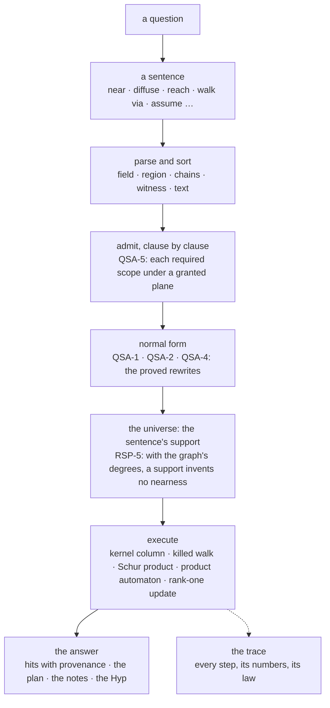
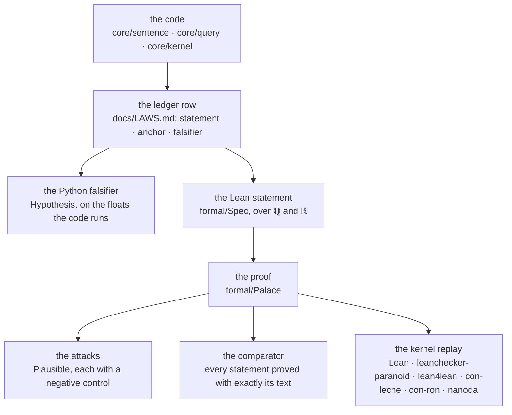

# Mind Palace

[](https://github.com/ascalva/mind-palace/actions/workflows/ci.yml)
[](https://github.com/ascalva/mind-palace/actions/workflows/lean.yml)
[](docs/LAWS.md)
[](formal/README.md)
[](formal/sorry-budget)
[](formal/check.sh)
[](formal/PalaceTest)
[](docs/runbook.md)
[](pyproject.toml)
[](pyproject.toml)
[](scripts/check_imports.py)
[](pyproject.toml)
[](LICENSE)

> A personal knowledge system queried in a small typed language. Each answer carries the notes it drew on, the plan that produced it and, on request, a trace of every step. Each operation the language performs is a law recorded in a ledger and proved in Lean.

Two names, deliberately: **mind-palace** is the framework, this repository. **Ouroboros** is the live instance, the always-on daemon over one person's notes, code and reading, named by its own founding note ("is that the name i would give this study on process? ouroboros"). The framework is public; the corpus never is.

## The query language

A person at a terminal and an agent over MCP ask the same way: with a sentence of the query algebra, a typed term compiled under a grant that fixes what it may read.

```text
top 5 near "sleep" and diffuse S from "health.md"
reach F from "core/sealing.py" depth 2 as of "9ec8689"
top 8 near "Kaplansky's direct finiteness" over curated
walk from "note-2026-07-11-000843" via S+F* depth 3
assume sever S "a.md" "b.md" in top 3 diffuse S from "a.md"
read "reference:openai-math:Local-smoothing" chunk 3
```

There are five sorts: a *field* (a score on every node), a *region* (a set of nodes), *chains* (paths that spell a word over the edge types), a *witness* (the commit that minted an edge) and a *text* (one record). The verbs move between them: `near`, `diffuse`, `reach`, `relate`, `trace`, `walk … via`, `witness`, `read`. The connectives compose them: `and`, `or`, `minus`, `then`; `within`, `over` and `as of` restrict; `top k`, `atleast t`, `far` and `not` bound; `assume … in` evaluates a sentence under a hypothesis, and its answer is a `Hyp` beside the actual answer, never a fact. The grammar is `core/sentence/grammar.py`; [`docs/query/asking.md`](docs/query/asking.md) is the guide to writing a sentence.

Two surfaces share one grant. `mind-palace query "<sentence>"` runs a sentence read-only from the live checkout. The Ambassador's MCP server has one read tool, `query`, and the Open WebUI bridge serves the same manifest. Both hold the Ambassador's grant with the hypothetical overlay the owner switched on; `--as <role>` labels the asker in the query log and grants nothing. A third surface holds a narrower grant: `scripts/palace_mcp.py --role guest` serves an external agent `query` and `overview` alone, read-only over the dialogue, the repository's code and docs, the papers and the observed records, never the notes or the interpretations derived from them (SCO-9, `docs/design-notes/dn-guest-principal.md`); it is how the code instance below serves a coding agent. A sentence that cannot be answered is refused with the reason: the production that failed to parse, the sort rule it broke, the plane no grant covers, the note that matched twice. It is not answered with nearest neighbours instead.

## From a sentence to an answer



The compiler types the sentence and checks, clause by clause, that the scope each clause needs (its strata, edge classes, clock and window) lies under one of the grant's planes (QSA-5); an ill-scoped sentence is never constructed. The planner rewrites to a normal form by identities proved before the code was written: `within` is pushed to the leaves because a mask distributes over the Schur product and masks stack by intersection (QSA-2); `and` is flattened and ordered because the product is commutative and associative (QSA-1); a positive threshold passes through a mask and `top k` does not (QSA-4). The universe builder restricts the evaluation to the sentence's support: the strata its admitted clauses name and nothing else, papers and code by nearest-neighbour seeding, the citation graph at the cut the sentence names. It keeps the graph's degrees on that support where it knows them, exactly for the notes and the dialogue and by a census for papers, which is the hypothesis under which a support can underestimate nearness but not invent it (RSP-5). A file's degree is induced and a census cut at the support undercounts; the answer's notes name both, as the places the bound does not hold. The executor's arithmetic is then the ledger's.

## The verbs and the mathematics


| sentence | what it computes | the laws |
|---|---|---|
| `near "t"` | the kernel column `clip(V·q̂, 0, 1)`: one cosine per node, never an `n × n` product | QSA-3 |
| `diffuse S from n [beta b]` | the randomized-shortest-path curve: `W_β = z·D⁻¹W∘W^β`, `Z = (I − W_β)⁻¹`, `φ_ij = −log(z_ij / z_jj)/β`, `score = e^{−φ}`; β→∞ is shortest path, β→0 resistance; on a support, with the graph's degrees | RSP-1 to RSP-5 |
| `f and g`, `f or g` | the Schur product `f ⊙ g`, which stays in the positive cone; the convex mixture, the mean of every disjunct in the chain | QSA-1, QSA-3 |
| `s within r`, `s over σ`, `r then s` | masks: congruences of the kernel that distribute and stack by `∩`; `over` masks onto strata | QSA-2, QSA-10 |
| `top k f`, `atleast t f` | ranking, which does not commute with a mask; a threshold, which does | QSA-4 |
| `reach F from n depth d` | breadth-first over the typed edges at the sentence's cut | structural |
| `walk from n via p` | the product of the typed graph with the regular expression's automaton, dead states pruned | QSA-7 |
| `assume S a b +w in s` | a rank-one update `L ↦ L + w(e_a − e_b)(e_a − e_b)ᵀ`; adding weight raises no effective resistance, removing it lowers none; the sever horizon `w·R_eff ≤ 1`, with equality exactly at a bridge | QSA-9, CND-2, SEV-3 to SEV-5 |
| `assume contradict a b in s` | a negative relation edge; the signed Laplacian's zero mode lifts iff the camps break, by at most `4·F_w/n` | LAP-5, LAP-6, FRU-1, FRU-2 |
| `read r [chunk n]` | the record, held to the stratum its ref names | structural |

## Security

Every node carries its stratum: the owner's notes, the dialogue, the curated literature, the repository's code, the interpreted layer, the observed layer, and the hypothetical overlay. Every clause names the strata it walks. A grant is a set of scopes, one per clock plane; a sentence is admitted only when each clause fits under one. Admission then bounds the read: the universe a sentence is evaluated on holds only the strata its admitted clauses name, each clause is evaluated on its own strata and answers within them, and naming a node outside a clause's strata is a clause of its own that the grant must admit. The Ambassador's base grant admits no hypothetical; the owner's overlay grant names the overlay stratum on each plane and widens nothing else (no world reach, the same clocks, windows and fibers). The read-only mirror of what the owner wrote and the write-only path to the world are different objects, by type; the sealed core cannot name a network module, and an import firewall checks that on every run. The query log records who asked, which strata, which modes, what came back and why a refusal, and never a note's text.

## The trace

`--trace` (over MCP, `trace: true`) returns the work alongside the answer: the parse and its sort; every rewrite of the normal form with the law it rests on; the clauses' scopes and modes and the admission; the support's census; each clause's arithmetic with its numbers; a hypothesis's rank-one update and its sever horizon; the ranking; and the laws cited, once each. It contains refs and numbers only, never a note's text. Off, each hook is a single `None` check; on, nothing is recomputed. It exists because a query language needs debugging like any other.

```text
trace (the proof of work):
  plan:
    - `and` ordered canonically: the Schur product is commutative and associative  [QSA-1]
    - within stays over `top`: ranking does not commute with the mask  [QSA-4]
    - admissible: each of the 3 clauses' required scopes lies under a granted plane  [QSA-5]
  eval:
    - reach F from 'a.md' depth 1 both: breadth first over the typed edges, frontiers [1]; 1 reached
    - diffuse S from 'a.md': the killed walk W_β = z·D⁻¹W∘W^β on 4 nodes and 2 edges, β = 1, z = γ = 0.5; Z = (I − W_β)⁻¹, φ_aj = −log(z_aj / z_jj)/β, score e^{−φ}; 2 nodes reachable; best: b.md 0.3405, c.md 0.0989  [RSP-1, RSP-4]
    - near 'q': the kernel column s = clip(V·q̂, 0, 1) over 4 nodes; 2 positive; best: a.md 0.9487, b.md 0.3162  [QSA-3]
    - and: the Schur product f ⊙ g; 2 positive ⊙ 2 positive → 1 positive; best: b.md 0.340×0.316=0.1077  [QSA-1, QSA-3]
    - top 2: 1 kept of 1 positive scores, ties kept; the cut is 0.1077  [QSA-4]
  laws: QSA-1, QSA-4, QSA-8, QSA-5, RSP-1, RSP-4, QSA-3, QSA-2 (the ledger rows in docs/LAWS.md, the design theorems in formal/Palace/)
```

## From a law to a proof



A law has one row in [`docs/LAWS.md`](docs/LAWS.md): its statement, the structure it rests on, the code it anchors to, its label, the Python test that would catch it being false, and the Lean declarations that state it. The Lean side is a sibling package with no import coupling to `core/` in either direction: a model of the code's definitions (`formal/Palace/X/Defs.lean`), the statements over that model with their proofs left open (`formal/Spec/X.lean`), and the proofs (`formal/Palace/X.lean`). `lake comparator` judges the proofs against the statements, so a proof file cannot change what is proved. The export of everything the statements reach is replayed from nothing through Lean's kernel and five independent checkers, two of them formally verified. Every declaration is audited against the three standard axioms, the `sorry` budget is zero and only goes down, and a cross-reference check holds the ledger, the statements and the docstring markers to one another. Laws proved before any code relies on them (design theorems) live in `formal/Palace/` under their own ids and enter the ledger when code does.

| | |
|---|---|
| toolchain | Lean `v4.36.0-rc2`, Mathlib; Plausible for the attacks |
| the library | 38 proof modules, 37 models, 27 statement files; 25,700 lines of models and proofs, 3,841 of statements, 5,757 of attacks |
| theorems | 1,544 proved in `formal/Palace`; 380 statements in `formal/Spec` judged identical by the comparator |
| the ledger | 106 rows in 16 families, 386 cited declarations, 93 law markers checked against the rows |
| attacks | 232 Plausible attacks and 206 negative controls over 33 modules, fixed seeds |
| axioms | `propext`, `Classical.choice`, `Quot.sound`; `sorry` 0 |
| the replay | 56,238 declarations accepted by all six checkers on the run of `formal/check.sh` this commit was built with |
| families | memberships · Laplacian, balance and spectral · cut and conductance · curvature · the global event clock · the shared prose plane · capability scopes · the abstraction ultrametric σ* · bridges · the retrieval curve · the query sentence algebra · the ingress · stored vectors · the growth readout · the utility field · the temporal snapshot |

## The mathematics

- **The retrieval curve.** `diffuse` walks a randomized shortest path with one parameter, β. As β grows the distance becomes shortest-path distance; as it shrinks, resistance distance; in between, every path counts, weighted by its cost. The kernel behind it is positive definite at every β on a connected support whose every degree is positive, the free energy is a quasi-metric (on the whole graph and on a support), and on a support that keeps the graph's degrees it can underestimate nearness but not invent it (RSP-1 to RSP-5).
- **Positivity.** `and` is the Schur product, which keeps two positive semidefinite kernels in the cone; `diffuse`'s kernel is one at the default β, and `near`'s, the cosine clipped to `[0, 1]`, need not be. Masks are congruences, so `within` and `over` push through `and` to the leaves and stack; a threshold passes through a mask and a ranking does not, which is why `top k` is the last thing a plan does (QSA-1 to QSA-4).
- **Hypotheses.** `assume` is a rank-one update of the Laplacian. Adding weight raises no effective resistance and removing it lowers none (Rayleigh's monotonicity, CND-2). A new contradiction keeps the camps exactly when its sign agrees with them, and between notes already joined by a path, a disagreeing one leaves no camps at all (QSA-9). Severing has a horizon: an edge's weight times the resistance across it is at most one, with equality exactly when the edge is a bridge, the one case where the response is singular; on the live backbone the eleven bridges are the eleven edges at the horizon. A contradiction lifts the signed Laplacian's zero mode by at most four times the frustrated weight over the number of notes (SEV-3 to SEV-5, FRU-1, FRU-2).
- **Paths as regular expressions.** `walk from n via S+F*` compiles the expression to an automaton and walks its product with the typed graph. A chain is admissible exactly when the automaton accepts it, pruning dead states loses nothing, and a hypothetical edge only adds chains (QSA-7).
- **The abstraction ultrametric.** σ\* is read off Kruskal's forest, which keeps every threshold's components; the forest sweep and the union-find sweep agree (SIG-1 to SIG-4).
- **Three Laplacians.** The plain Laplacian gives components and conductance; the signed one decides whether a web of support and contradiction is balanced; the magnetic one carries a phase around each cycle, with the signed Laplacian as its ℤ/2 fiber. The Hodge 1-Laplacian splits edge flows into gradient, curl and harmonic parts and counts holes (LAP-1 to LAP-11, BRG-7).
- **Transports along supersession.** When a note supersedes another, cochains pull back and push forward along the map. Under a merge the pullback is not a contraction, contrary to a ratified note; it is an isometry under the fiber-weighted inner product, the push-forward contracts under its inverse, and the curvature of the superconnection is supported exactly on the severed citations (TRN-1 to TRN-5). The pullback is a contraction exactly when nothing merges, which is what the versions store enforces. Under the confidence weight γ^depth, a machine step one level deeper contracts the energy by exactly γ (the norm by exactly γ under the weight γ^2·depth), a merge keeps every cochain's energy from growing exactly while γ times the widest fiber stays at most one, and an owner promotion multiplies the energy by γ^-k. Measured as mass, the weighted ℓ¹ norm, no machine step adds any, merges included: there the owner is the only source (TRN-6 to TRN-9).
- **A leak costs a step of temperature.** If the census feeding a support counts every degree at no less than `1/(1+ε)` of the true one, an under-count of at most `ε/(1+ε)`, and `(1+ε)·z < 1`, the support's nearness is bounded by the whole graph's at killing `(1+ε)·z`, uniformly in depth (LEAK-1, LEAK-2).
- **Floats.** The float claims are proved over a model of binary64 round-to-nearest that is itself checked, bit for bit, against this machine's arithmetic (Binary64, Roundoff).

## Why it exists

Before it is a tool, this is a living thought experiment: one person seeing how far physics and mathematical intuition can be pushed into running code without losing rigor on the way. The method is the project. An intuition (conductance between two thoughts; a helix of revisitation; proper time inside a corpus; memory as a graph at a past cut) is admitted only if it can be bounded by mathematics (an ultrametric, a circuit law, a gain graph, a certified snapshot), made representable and constructable in typed code, and validated by the system itself: every design decision ships with a named falsifier, every instrument carries the observable that would prove it wrong, and the numeric checks run before the prose is committed. A metaphor that survives formalization becomes an instrument; one that does not is recorded, with the reason it failed, in the same ledger.

Utility is a side effect and is treated as one. What the project optimizes for is the loop itself: conversation, capture, design note, code, findings, and back into design, with the system increasingly able to observe that loop running through it. The point is not to produce answers but answers that carry their reasons: where a belief came from, what it is allowed to affect, and whether it still holds.

## Architecture

- **The query algebra.** `core/sentence/`: the grammar, the sorts, the compiler and planner, the universe builder, the executor, the trace, the surfaces. The one read.
- **Ambassador.** The reasoning layer, over MCP and the web bridge. Computationally light, deterministic where exactness matters, and plain about how much effort an answer took.
- **Dreamer.** The offline layer that works over the structure of what is stored. Deterministic clustering feeds model synthesis; the outputs are content-addressed proposals that cannot silently become beliefs.
- **The store and its typed views.** The shared prose plane with its clearances, the curated literature store held structurally apart, the ledger of the repository's own history (three million citations over 1,487 commits), the version chains, the causal edges. A read-only reflection of memory and a write-only path to the world, distinct by type.
- **Provenance and scope.** Every item carries its origin class and what it may affect; the self-model reads only what the owner actually wrote. Code enters as a sensed stream: the repo is an instrument, never a voice in the mirror.
- **The airlock and the curated stratum.** A one-way path for outside research, de-identified on the way out and unable to reach back in. What returns is ranked locally against the private corpus; open-access sources go into a separate curated store, ground truth about the world that is never merged into the mirror.
- **The formal library.** `formal/`: the ledger's laws in Lean, attacked before they are proved and judged after.

## Status, stated honestly

The base build is complete and the live instance runs always-on under launchd with a gated deployment path. "Complete" is not "wired": this repo distinguishes built, deployed and wired, and its own audit found the summaries were the least honest surface, so this one names the gaps.

Wired and live: ingestion (notes within seconds, code per commit), dreaming on a six-hour cadence, the provenance firewall, the attestation chain, the strict-typed core, CI on every push, deploy-gated releases, the research airlock, the curated literature store, and the query language with its one MCP command, the CLI, the query log as a sensor, and a battery run read-only against the live stores. Built but deliberately dormant, each waiting on its design gate: retrieval demotion for superseded content, the supersession certification layer, effectors (the "hands", flag-off at every tier), recursive dreaming. Open in the language, and stated in every answer: version moves at the note grain are empty (the chains are per note), and there is no snapshot of the notes at a past cut. The causal moves are wired: a transcript turn to the files it produced, and back. So is the ingress: ingestion is written in a generic language, and each path, from the vault sync to a capture, is a script of it (`ingress/`). A surface speaks a request, `do sync_vault` or a script inline, typed under the speaker's grant; the daemon evaluates it under a budget of measured work into a plan and lands the plan as the one writer, under the palace's rules, and the answer is a receipt. The Ambassador's write tools are requests, and its inbox lands the owner's messages through a script of its own, under a role that writes nothing else. Landing is two-phase where an instance asks for it (`[embedding] lazy`): an item lands complete without its vector, with its bytes, label, edges and a lexical index, and the `embed` drain derives the vectors afterwards, idempotently; a query that needs a vector not yet derived reports the item pending instead of guessing (ING-19 to ING-21). The default instance keeps synchronous embedding. An instance may also embed nothing (`[embedding] enabled = false`), and a source may keep no vectors (`[ingestion.code] embed = false`): its items land with their lexical units and no vector, and `near` ranks them by the lexical index and says so. The code instance (`config/instances/code.toml`) lands this repository's files that way, read through git at `main`, for a coding agent to query over MCP. Left for later: research, a paper's manifest, and one commit's or one session's backfill as scripts, and the parallel dispatcher, whose laws are proved (DO-6).

The current frontier is the query algebra as the system's interface, the mathematics pushed to where its claims close or break, and the trace as the language's debugger. Behind it, drafted: the palace's memory of itself, the graph as it stood at any past cut, and the conversations that design the system becoming a stratum it can study.

A note on scope: the rigor here governs how outputs are produced (their provenance, their limits, whether they still hold). Whether the outputs are insightful is a separate question the reasoning layer has to earn against real use, not against provability. That gap is named on purpose.

## How it is built

By a human and AI agents, in the open. The human owns direction and merges every pull request; agents propose, implement and verify. The operating rules are in [`CLAUDE.md`](CLAUDE.md) (the bright lines, how work lands, where things are), and the gates are mechanical: ruff, the import firewall, mypy, the type gate, the deterministic test tier, and `formal/check.sh` whenever the library or the ledger changes. CI runs the same gates on every push. Work lands design first: a law is stated and attacked in Lean before the code that relies on it is written, the code transcribes the proof, and a finding that bears on a settled design is filed as an issue for the owner to rule on.

The build's own history is a dataset. Every commit's structure is snapshotted into a queryable ledger by a model-less sensor, so `reach F from "core/query.py" as of "<cut>"` is a sentence the palace answers about itself. A literature pass caught a misattribution in a ratified design (a kernel result credited to Mercer that is properly Moore–Aronszajn), and the formal work refuted a ratified claim about the pullback along a supersession; both corrections went back through the owner.

## Verification

```sh
uv sync --extra dev
uv run pytest -q -m 'not live and not podman and not needs_vault and not needs_restic'   # the deterministic tier: 3,769 tests
uv run mypy                                        # strict core: 0 errors (the 67 in tests/ are pinned)
uv run python scripts/check_imports.py             # the sealed core names no network module
uv run python -m ops.type_gate                     # every core-reaching package is type-checked
(cd formal && ./check.sh)                          # build · attacks · lint · budget · audit · six kernels · comparator · ledger cross-reference
bin/mind-palace query 'top 5 near "sleep" and diffuse S from "health.md"' --trace   # from the live checkout
```

The suite is tiered by intent (unit, integration, property, metamorphic, adversarial, integrity, longitudinal, emergent), so an invariant regression reads differently from a flaky assertion; the property tier is the ledger's Python falsifiers. Live axes (`-m live`, `-m podman`, a dev-Vault CI service) verify against the real substrates and are skipped when absent. Line-and-branch coverage over the deterministic tier is 77%, reported rather than gated: a structural test that deletes an illegal state matters more than a line touched.

## Running it

Local by design: your hardware, a local model server, notes in a plain markdown vault, the core backed up encrypted. Nothing depends on a service staying up. [`docs/runbook.md`](docs/runbook.md) is the operational manual, from `uv sync` to the always-on launchd lifecycle; [`docs/query/asking.md`](docs/query/asking.md) is how to ask.

## Repository

- [`CLAUDE.md`](CLAUDE.md): orientation for every agent session, the bright lines, how work lands, where things are. Start here.
- [`CONSTITUTION.md`](CONSTITUTION.md): the fixed directives every agent inherits.
- [`CONVENTIONS.md`](CONVENTIONS.md): engineering and security practice, including the commit and deploy rules.
- [`docs/LAWS.md`](docs/LAWS.md): the ledger, every law with its anchor, its falsifier and its Lean.
- [`formal/`](formal/README.md): the Lean library, models, statements, proofs, attacks and the gate.
- [`docs/design-notes/`](docs/design-notes/): the design record; [`dn-query-sentence-algebra.md`](docs/design-notes/dn-query-sentence-algebra.md) is the language's.
- [`docs/query/asking.md`](docs/query/asking.md): the guide to writing a sentence.
- [`docs/BUILD-SPEC.md`](docs/BUILD-SPEC.md): the master specification; [`docs/PROGRESS.md`](docs/PROGRESS.md): the build log.
- [`docs/runbook.md`](docs/runbook.md): how to run, verify and operate it.

## License

AGPL-3.0. You are free to use, study and build on it; derivatives, including anything run as a hosted service, stay open under the same terms. Lineage preserved.
